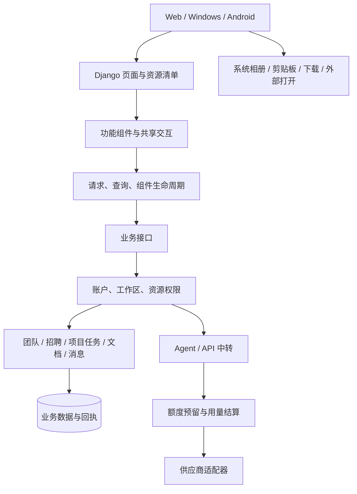

# 知域 0.6.1 架构约定与本轮改造

日期：2026-10-10；2026-10-11 补充 API 路由、助手执行与 0.6.2 组件导航。各轮原生构建、安装与部署状态以最新交付记录为准。

## 1. 本轮结论

知域继续采用 Django 模块化单体：资源权限与业务写入在服务端执行，Web、桌面和手机共用业务契约。现有规模先把模块边界、请求状态和组件生命周期做清楚。以下借鉴结论是针对知域的设计判断，相关软件的具体机制见第 7 节。

完成集中前端依赖、共享请求与组件生命周期。0.6.2 的项目和任务列表复用固定组件，通过 JSON 刷新数据；普通入口仍由 Django 渲染。没有安装 Turbo、TanStack Query、Frappe、LiteLLM 或 LangGraph，全站导航还在逐模块迁移。

## 2. 现在的模块边界

图中表示职责和调用关系；不是每条路径都已迁入新的前端 Runtime。旧脚本仍有直接 fetch 和全局监听，按模块逐步迁移。

| 层 | 当前实现 | 约定 |
| --- | --- | --- |
| 页面依赖 | `core/frontend_assets.py`、`core/templatetags/frontend_assets.py` | 共享依赖先加载，单次页面渲染去重；渲染器可通过 `frontend_features` 显式声明功能 |
| 请求与组件 | `static/core/app-runtime.js` | 查询可合并；写入不合并、不自动重试；组件负责取消和清理 |
| 共享交互 | `app-components.js`、`app-experience.js`、`conversation-workflows.js` | 图标、菜单、确认、收件人选择共用契约 |
| 业务资源 | `core/resource_registry.py` 及各资源权限模块 | 项目、任务、文档等的名称和搜索字段集中登记；接口独立鉴权 |
| 团队与招聘 | `core/teams.py`、`core/recruitment.py` | 生命周期、容量、有效岗位决定业务状态；页面不自行推断权限 |
| 模型调用与账目 | `aihub/service.py`、`gateway.py`、`funding.py` | 调用预留、上游执行、结算、未知结果处理分开 |
| 助手执行 | `aihub/agent.py`、`execution.py`、`inputs.py`、`tool_policy.py` | 持久队列、执行租约、工具回执、检查点与追加输入；生产使用独立 worker，本地预览使用同一队列的进程内 worker |

## 3. 前端依赖清单

基础脚本 → 工作台壳 → 共享转发/表情 → 聊天、留言、任务或 AI 功能。账户菜单用量是工作台共享组件；用量图表是 API 页面功能。

重要约定：

- URL 是入口。校验失败后的实际页面可能与入口不同，详情页渲染器必须声明其功能。任务进度错误返回已据此修正，原输入和字段错误保留。
- 新功能在清单声明依赖，不往基础模板继续塞脚本。未知依赖和循环依赖直接报错。
- 聊天表情发送从成员资料脚本分离为 `chat-stickers.js`；招聘页面不依赖 Emoji Mart、聊天引用或本地聊天历史。
- `account-usage.js` 负责通用账户菜单；`usage.js` 负责 API 用量图表。业务页面不因图表拆分失去额度显示。
- 详情中的留言表情仍依赖共享表情与长按菜单，不能因页面没有聊天消息而删除这些依赖。

实际浏览器渲染的 JS 清单如下。大小为本地未压缩文件字节之和，不是网络传输体积或加载时间基准。手机注入资源和 Emoji 数据 JSON 不计入该表。

| 页面 | JS 文件数 | 未压缩 JS 大小 |
| --- | ---: | ---: |
| 官网 | 8 | 32,193 字节 |
| 招聘管理 | 22 | 126,489 字节 |
| 任务详情、进度错误页 | 27 | 251,219 字节 |
| AI 助手 | 31 | 303,061 字节 |
| 私聊 | 34 | 324,679 字节 |

CSS 仍共用现有清单。后续要按组件清理重复覆盖、提取公共尺寸和强调色；这部分本轮未完成。

## 4. 共享 Runtime 契约

### 请求与查询

`json(address, body, options)` 只访问当前服务；带 body 使用 POST，否则 GET。默认超时 20 秒，JSON、FormData 和 URLSearchParams 有明确序列化契约。供应商请求继续由服务端代理，密钥不进入这个前端层。

`query(address, options)` 用账户、工作区/资源范围和完整 URL 标识查询。并发 GET 共享一次网络请求，返回值独立复制。默认不保存完成结果；显式 TTL 最长 60 秒，最多 128 个条目。当前转发目录使用 30 秒 TTL，账户额度与导航树使用默认行为。

成功或失败的 Runtime 写入都会清除查询缓存并推进查询版本。写入前发出的旧查询不能恢复旧状态；缓存命中后的微任务同样检查版本。401、403、404 清除查询缓存，JSON 和 HTML 拒绝响应都处理。这里的“清除”指 Runtime 查询缓存，其他存储仍由各模块负责。

写入不自动重试。断线、超时、部分服务器异常可能已产生业务结果，返回 `RequestError.uncertain`。能够重试的业务必须已有服务端幂等凭据与回执，例如文件转发。单纯重新发起 POST 不能当成恢复机制。

### 搜索与组件

`latest()` 取消前一轮任务，并用序号拦下迟到的成功或错误。即使底层请求没有响应取消，旧结果也不能覆盖新列表。组件断开连接后不能接收异步结果。

`mount(name, root, setup)` 对同一根节点和名称只初始化一次。`scope.on` 登记监听，`scope.cleanup` 登记清理，`scope.latest` 跟随生命周期。卸载会取消任务并移除监听；某项清理报错时其余清理仍执行。错误会汇总抛出，不能静默遗漏。

`pagehide` 取消读取与组件请求并清除查询缓存，保留事件绑定，以支持浏览器返回缓存恢复。已接入：聊天业务引用搜索、项目导航树、任务布局、成员资料读取、AI 引用搜索和账户用量组件。全部旧模块完成迁移之前，不启用全站局部页面替换。

## 5. 后续业务与 Agent 约定

本节是后续改造约定，不是本轮已经实现的新能力。

### 业务命令

移动端和桌面应调用相同业务服务。命令入口负责登录、工作区与资源权限；服务负责状态校验、事务写入和回执；提交成功后的事件才刷新相关列表。缓存中的权限和隐藏按钮都不能代替接口鉴权。

| 操作 | 必须同时处理 |
| --- | --- |
| 关闭或暂停招聘 | 职位状态、广场结果、申请入口和列表失效 |
| 退出或解散团队 | 身份、当前工作区、邀请、招聘和凭据访问；成功后回到可访问页面 |
| 项目/任务编辑 | 校验失败保留输入，实际渲染页面保留组件；写入冲突有明确结果 |
| 消息引用/转发 | 原内容状态、发送者权限、接收者访问、附件范围与发送回执 |
| 文档/文件 | 预览状态、原文件保存、外部打开、下载进度与失败恢复 |

### API 中转与记账

路由规则、供应商执行和账目分开。逻辑模型下的部署候选应记录优先级、健康状态、冷却和并发限制；多进程共享的限制不能只靠单个 Python 进程内变量。

一次逻辑调用对应可追溯的上游尝试。只有能证明未执行、未扣费的失败才可自动切换；已经发出而结果未知的调用进入核对路径。响应后重复结算、退款或重置都应受到数据库状态与凭据保护。重置周期用量不抹除历史账目或未结算预留。

2026-10-11 已增加外部 API 的一主一备、数据库共享熔断、恢复租约和尝试分组；各次尝试复用既有 Call 账本独立预留、结算，公开请求编号稳定。迟到结果按连接代次隔离。0.6.2 内置助手接入同一路由，保留实际供应商的完整工具消息和计费归属。多层候选、负载均衡和供应商对账尚未完成。接口与限制见 [API_RELAY_0_6_1.md](API_RELAY_0_6_1.md)。

### 内置 Agent

本次 Agent 改动已加入按项目、操作、期限和次数限定的执行授权，第一批工具为创建任务、更新进度及保存文档修改稿。工具参数通过统一注册清单校验，调用共享业务命令；本地写入与持久回执在同一事务提交。重试复用相同操作组和参数的成功回执。具体契约与限制见 [AGENT_0_6_1.md](AGENT_0_6_1.md)。

当前 `start()` 原子登记 AssistantJob 和初始事件，独立 worker 领取任务与续约；本地预览可使用同一队列的进程内 worker。检查点保留模型消息、工具结果与待处理步骤，已经提交的业务写入复用持久回执。结果未知的上游调用停在核对状态，不在重启后自动重发。

运行中追加指令使用有序输入队列与客户端幂等凭据。工作者在调用、工具写入和结束前接收输入；新的输入与旧指令的写入并发时以数据库锁确定顺序。撤销、次数、范围和身份始终重新校验。事件按游标分页，刷新恢复执行状态。整轮上下文裁剪保留完整工具调用配对，尚未实现语义摘要或 token 精确预算。

Codex / DeepSeek Harness 固定提交来源和职责划分见 [HARNESS_REVIEW_0_6_1.md](HARNESS_REVIEW_0_6_1.md)。已实现契约、恢复边界与验证证据见 [ASSISTANT_EXECUTION_0_6_1.md](ASSISTANT_EXECUTION_0_6_1.md)。

### 模块与插件

功能注册分成 UI 清单、资源能力、Agent 工具和后台事件。插件不能直接修改其他模块的表、偷偷挂全局监听或绕过资源权限。后台事件在事务提交后发出；启停插件要能卸载监听、取消任务并检查数据版本。当前已实现前端依赖清单及四个内置 Agent 插件的工具注册和账户启停；第三方安装、运行隔离与后台事件扩展尚未实现。

## 6. 验证与推进顺序

此前组件架构批次：26 项 Runtime 测试、59 项 Django 测试、83 项实际浏览器检查通过，未捕获页面异常 0 条。语法与 `git diff --check` 通过。

本次授权 Agent 批次：166 项 Django 检查、26 项 Runtime 检查、30 项浏览器与集成检查通过。包括新账户额度并发初始化、实际工具写入和回执导航；没有执行真实供应商付费推理。详细证据和能力边界见 [AGENT_0_6_1.md](AGENT_0_6_1.md)。这两批覆盖有重叠，不将检查数量相加。

测试覆盖账户/工作区隔离、权限失败、写入失效、取消、旧搜索迟到、生命周期、表情直接发送、转发断线回执、文件下载、招聘/团队入口、任务错误恢复和普通工作页额度。使用合成数据，没有执行真实供应商付费推理。

下一阶段按依赖推进：

1. 把剩余事件与请求迁入组件生命周期，整理重复 CSS，建立每个组件的加载、空、错误、提交中与成功状态。
2. 在少量已迁移列表页实现固定骨架与数据刷新，保留完整导航、历史返回、焦点和失效回退；验收后扩展范围。
3. 收拢业务命令与提交后的失效事件，再实现路由共享状态。
4. Agent 队列、租约、检查点、追加输入、有序事件与整轮上下文裁剪已做隔离业务和实际浏览器验证。接下来完善摘要和插件生命周期，再扩展业务工具。实现边界见 [ASSISTANT_EXECUTION_0_6_1.md](ASSISTANT_EXECUTION_0_6_1.md)。
5. 真机验收键盘、返回、系统下载、剪贴板及相册，再构建安装包。

## 7. 公开源码借鉴依据

以下描述来源机制；“知域采用方式”是本次判断。源码以归档提交和 SHA-256 记录，未作为新运行依赖导入。

| 项目与一手来源 | 阅读到的机制 | 知域采用方式 |
| --- | --- | --- |
| [Turbo PageView](https://github.com/hotwired/turbo/blob/75350a19212ef0d29a0e6db75e0bfdeb96b10cd7/src/core/drive/page_view.js) | 快照缓存前通知代理，保存克隆；渲染选择和强制重载有明确入口 | 先定义卸载、返回恢复和资源身份，再推进局部导航 |
| [TanStack Query](https://github.com/tanstack/query/blob/e3ef1387054c88bed7cb031e0f1e26bf7c99bddc/packages/query-core/src/query.ts) | 查询复用正在执行的 Promise，取消和观察者生命周期分开，显式处理失效 | 页面内 GET 合并、订阅取消、写入版本失效；按知域范围隔离 |
| [Frappe Document](https://github.com/frappe/frappe/blob/cf1ba2641e47a6f2efa19791eb8bc710ff438633/frappe/model/document.py) | 保存时校验权限、版本与关系，写入后清缓存；实时通知使用 after_commit | 后续业务命令集中校验与事务，提交后统一刷新 |
| [Zulip 架构](https://github.com/zulip/zulip/blob/d7c57ed15b82b0bc8aefe2007f5ee2abeebd0ea2/docs/overview/architecture-overview.md)、[性能说明](https://github.com/zulip/zulip/blob/d7c57ed15b82b0bc8aefe2007f5ee2abeebd0ea2/docs/subsystems/performance.md) | 区分服务端、浏览器、原生客户端；权衡首屏数据和消息加载成本 | 公共壳与重功能分开；缓存有范围、数量和有效期 |
| [CC Switch 路由器](https://github.com/farion1231/cc-switch/blob/790ed8009df809bedaf6c31b5ced05da46bb1f1f/src-tauri/src/proxy/provider_router.rs) | 候选队列、供应商可切换条件、熔断结果与许可管理分开 | 为路由模块定义可切换条件，避免跨账户凭据复用 |
| [New API BillingSession](https://github.com/QuantumNous/new-api/blob/c6741c36a9a1a729554ad94ee99f21602a214a23/service/billing_session.go) | 预扣、资金结算、令牌调整、退款各有状态保护，处理部分结算 | 保留知域调用账本与未知结果，不把路由重试当作退款凭据 |
| [LiteLLM Router](https://docs.litellm.ai/docs/routing) | 部署级冷却、模型组候选以及共享限额；限制范围有进程内与 Redis 之分 | 后续路由状态和并发限制明确进程边界 |
| [LangGraph Checkpoint](https://github.com/langchain-ai/langgraph/blob/6aa0afba682b0308fbcace31f66fb532978d4dca/libs/checkpoint/README.md) | thread/checkpoint 标识执行状态，pending writes 保留成功步骤结果 | Agent 需要持久步骤与回执；当前线程执行器不具备该恢复能力 |

归档位置：工作区 `outputs/architecture-0.6.1/sources/manifest.json`。其中 LangGraph interrupts 的额外归档请求超时，没有计入成功保存的 9 份来源。其余 8 份仓库文件与 LiteLLM 官方页面均已保存摘要。

此前 Plane、Outline、Mattermost、Element X、BlockSuite 等 UI、协作及插件研究保留在 `outputs/architecture-research-20261009`，本轮不重新把研究内容计作已实现功能。

## 8. API 路由验证（2026-10-11）

- 85 项隔离业务测试通过，包括零费用切换、不同价格、限额、流式部分输出、并发恢复租约、迟到响应、重置和重复结算。
- 官方 OpenAI Python SDK 3.28.0 经真实回环 HTTP 完成 18 项检查，包括实时流解析、稳定编号、分组账单及禁止未知结果自动重试。上游为模拟供应商，没有执行付费调用。
- 34 项实际浏览器检查通过，覆盖 320/390 像素手机资源模拟与 1280 像素桌面，包含高级备用连接设置和负责人恢复连接；未捕获脚本异常。
- 独立日志、截图和原生交付结果在工作区 `outputs/relay-routing-0.6.1`。这一轮没有完成全站骨架导航、Agent 持久执行、第三方插件和真机验收。

## 9. 0.6.2 执行与组件导航验证（2026-10-11）

- 最终组合业务回归 251 项、请求 Runtime 28 项、官方 OpenAI SDK 回环 HTTP 18 项通过。组合业务覆盖助手执行、授权写入、路由、额度、项目任务列表和既有协作流程，不与此前数量相加。
- 助手浏览器检查 61 项、项目任务组件浏览器检查 49 项通过；320/390 像素手机资源模拟及 1280 像素桌面未捕获脚本异常。
- 项目和任务列表已实现固定组件与 JSON 数据刷新、筛选、分页、后退恢复、权限失效清理，契约见 [COMPONENT_NAVIGATION_0_6_2.md](COMPONENT_NAVIGATION_0_6_2.md)。范围仅这两个列表，其他页面保留原导航。
- 使用隔离账户、数据库和模拟供应商；未执行生产数据迁移、真实付费调用或 Android 真机验收。当前产物与安装状态见工作区 `outputs/release-0.6.2/完成说明.md`。
