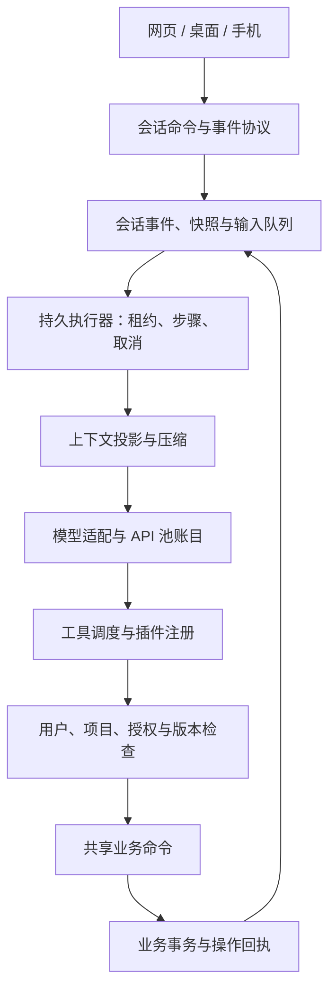

# Codex 与 DeepSeek Harness：知域执行架构对照

研究整理：2026-10-11。来源快照：2026-10-10。本轮补充源码研究与架构安排，没有把研究机制计入已实现功能。

上一批主要参考通用 Agent 框架的工具、过滤和检查点，遗漏了 Codex 与 DeepSeek Harness 的系统对照。此次将这两者作为执行架构的主要参考。现有三种业务写入、授权和事务回执继续作为知域的业务执行边界。

## 1. 阅读依据

从官方仓库读取固定提交文件，归档 31 份文件及 SHA-256；精读下表列出的函数、类型和关键段落。归档文件数量不等于完整项目通读。没有安装或运行这两个项目。

| 项目 | 固定提交 | 重点阅读 |
| --- | --- | --- |
| Codex | `806d9732c974bc8a51b8317c1bd8985544fe627c` | `session/turn.rs` 的 `run_turn`，`tools/orchestrator.rs` 的 `run`，`session/input_queue.rs`，`compact.rs` 的替换历史，`rollout/src/recorder.rs` 的持久写入，`session/daemon_recovery.rs` |
| DeepSeek Harness | `d743267388641bc76f17c45ce8b4c231aed1d32c` | 架构说明，`agent-loop/src/agent.ts` 的 `turn/step/cancel`，`tool-calls.ts` 的调度，`tools/src/index.ts` 的执行守卫，作用域清理，压缩配对，存储句柄契约 |

归档目录：工作区 `outputs/harness-0.6.1/sources/`。`manifest.json` 保存文件路径、固定提交链接、大小和哈希；`index.json` 保存获取时的仓库目录。仓库中的说明文件是研究资料，不作为知域的本地开发指令。

官方背景说明：[Codex Agent Loop](https://openai.com/index/unrolling-the-codex-agent-loop/)、[Codex App Server](https://openai.com/index/unlocking-the-codex-harness/)。两篇文章发表于 2026 年初，具体机制以本次固定提交源码为准。

## 2. 对知域有用的机制

### 会话、工作轮次与执行步骤分别管理

Codex 用 Thread、Turn、Item 表达持久会话、一次工作和具体输入输出，App Server 将内部事件转换成客户端可消费的通知。执行时，`run_turn` 在下一次采样前记录追加输入，并为该请求捕获一致的步骤上下文。[App Server 说明](https://openai.com/index/unlocking-the-codex-harness/)、[执行循环源码](https://github.com/openai/codex/blob/806d9732c974bc8a51b8317c1bd8985544fe627c/codex-rs/core/src/session/turn.rs#L416)。

DeepSeek 的 `turn()` 追加 `turn/start`，每步追加 `step/start`，在工具结算后判断是否继续。`followup` 排到下一轮，`steer` 进入下一步，`inject` 提供上下文而不主动唤醒；取消默认清理待处理输入，也可以显式保留。[执行循环](https://github.com/deepseek-ai/deepseek-harness/blob/d743267388641bc76f17c45ce8b4c231aed1d32c/packages/core/agent-loop/src/agent.ts#L153)。

**知域安排：**网页、桌面与手机共同使用一套会话协议。模型、推理、联网和授权作为执行设置；消息、工具、回执、异常作为有身份的事件。运行中用户补充要求进入同一轮的输入队列。界面区分正在执行、已排队、等待必要输入、已取消、已结束，提供一致的停止和继续入口。

### 完整历史与模型上下文采用不同的表示

DeepSeek 将会话事件作为历史依据，再从事件投影出模型消息；瞬时流和已结算消息有不同生命周期。压缩选区必须保持工具调用与结果配对，成功压缩产生有事务标识的检查点。其存储句柄明确区分 `append` 的可见性和 `flush` 的耐久保证。[架构与历史](https://github.com/deepseek-ai/deepseek-harness/blob/d743267388641bc76f17c45ce8b4c231aed1d32c/docs/architecture.md)、[配对实现](https://github.com/deepseek-ai/deepseek-harness/blob/d743267388641bc76f17c45ce8b4c231aed1d32c/packages/compaction/compaction/src/tool-pairing.ts)、[存储句柄](https://github.com/deepseek-ai/deepseek-harness/blob/d743267388641bc76f17c45ce8b4c231aed1d32c/packages/session/session-persistence/src/handle.ts)。

Codex 的压缩替换同时考虑现场历史、持久记录及当前环境上下文；写入器通过队列和确认通道实现 `persist/flush`，写入失败保留未写后缀以便恢复。[压缩](https://github.com/openai/codex/blob/806d9732c974bc8a51b8317c1bd8985544fe627c/codex-rs/core/src/compact.rs#L65)、[写入器](https://github.com/openai/codex/blob/806d9732c974bc8a51b8317c1bd8985544fe627c/codex-rs/rollout/src/recorder.rs#L1062)。

**知域安排：**数据库保存原始事件和稳定标识；模型请求从已提交事件构建。按模型能力和上下文预算生成摘要检查点，保留最新输入、任务目标、对象版本、成功回执与未完成事项。压缩过程中保留原始事件。摘要只是背景信息，执行权利每次仍从业务权限和授权记录读取。对于不支持供应商专用压缩端点的模型，使用通用摘要适配；摘要请求也纳入 API 池计账。

### 授权位于工具实际执行边界

Codex 在统一工具编排器中判定跳过、禁止或需要审批，再选择执行环境和沙箱。审批状态与重试状态分别管理。[工具编排器](https://github.com/openai/codex/blob/806d9732c974bc8a51b8317c1bd8985544fe627c/codex-rs/core/src/tools/orchestrator.rs#L133)。

DeepSeek 在可扩展的执行前流水线之后运行单向收紧的守卫：任一守卫拒绝就不能执行，其他扩展不能强行放行；异步检查之后再检查取消。[守卫](https://github.com/deepseek-ai/deepseek-harness/blob/d743267388641bc76f17c45ce8b4c231aed1d32c/packages/core/tools/src/index.ts#L1133)、[执行前阶段](https://github.com/deepseek-ai/deepseek-harness/blob/d743267388641bc76f17c45ce8b4c231aed1d32c/packages/core/tools/src/index.ts#L1501)。

**知域安排：**复用已有用户、团队、项目、插件与授权检查。范围内操作连续执行；新增操作范围或确有必要的影响才进入持久审批。审批绑定动作、参数、对象版本和有效期。模型说明、网页内容、插件自己的放行结果均不能扩大业务权限。

### 取消后需要处理已经开始的工作

DeepSeek 的调度器区分可并行组与独占屏障。取消停止新的调用，等待已经开始的调用结算，按模型顺序记录结果；尚未开始的调用也得到明确的跳过结果。后续调用开始前重新读取并发模式，以反映注册状态变化。[工具调度](https://github.com/deepseek-ai/deepseek-harness/blob/d743267388641bc76f17c45ce8b4c231aed1d32c/packages/core/agent-loop/src/tool-calls.ts#L39)。

**知域安排：**独立读取可受限并行；相关业务写入先按对象串行。界面按 call/item 标识合并状态。点击停止后先显示“正在停止”，再收齐已开始步骤的回执与用量；已提交写入保持成功结果，未开始步骤标为跳过。取消不会撤销已经成功的业务事务。

### 插件注册、依赖和清理有生命周期

DeepSeek 基于 Cordis 提供可替换服务与作用域内注册。`createScope()` 创建拥有注册项的上下文，`dispose()` 等待异步清理完成；工具注册返回卸载函数。插件管理器也有独立的依赖声明和正在进行的包操作清理。[作用域](https://github.com/deepseek-ai/deepseek-harness/blob/d743267388641bc76f17c45ce8b4c231aed1d32c/packages/core/scope/src/index.ts#L120)、[工具登记](https://github.com/deepseek-ai/deepseek-harness/blob/d743267388641bc76f17c45ce8b4c231aed1d32c/packages/core/tools/src/index.ts#L1061)、[插件管理](https://github.com/deepseek-ai/deepseek-harness/blob/d743267388641bc76f17c45ce8b4c231aed1d32c/packages/boot/plugin-manager/src/index.ts#L176)。

**知域安排：**插件清单声明版本、能力、依赖和配置；注册拥有可撤销句柄。插件停用停止接收新调用，清理监听和资源，保留已有回执。MCP 作为外部工具适配层接入相同的权限、事件与用量边界。当前四个内置插件启停尚不具备这套完整生命周期。

DeepSeek 仍处于开发预览，官方明确提示会出现兼容性变化。知域采用其分层与生命周期原则；选用运行依赖前另行确认版本、部署成本及升级边界。[官方 README](https://github.com/deepseek-ai/deepseek-harness/blob/d743267388641bc76f17c45ce8b4c231aed1d32c/README.md)。

## 3. 知域当前差距

| 当前源码 | 可确认的问题 | 下一阶段处理 |
| --- | --- | --- |
| `aihub/agent.py: start/worker` | 进程内 daemon 线程承担工作，完整推理步骤没有持久检查点 | 独立执行器、工作租约、步骤记录和重启核对 |
| `aihub/views.py: assistant_chat` | 从最近 18 个任务重建用户与最终答案，取最近 20 条并按 100 KB 裁剪；跨轮工具协议历史没有完整重建 | 持久事件与模型上下文投影，再引入预算压缩 |
| `aihub/agent.py: worker` | 固定最多 8 次模型循环，没有运行中追加输入队列 | 在步骤边界消费输入，保留明确时间、费用与调用预算 |
| `AssistantJob.activity/partial/result` | 覆盖保存当前状态，可展示过程，但缺少可重放的事件游标 | 追加事件与快照版本，客户端重连补齐并去重 |
| `AgentOperation` | 已提交本地命令有事务回执，可复用同参数操作；没有模型请求完整检查点 | 保留回执事务，将步骤恢复与上游调用账目关联 |
| `tool_registry.py` 与插件设置 | 内置注册、发现与启停已经具备；没有第三方加载和作用域清理 | 插件契约、依赖检查、注册句柄和 MCP 适配 |

固定轮次上限本身是资源控制；问题是到达限制后缺少可继续的执行状态。不能直接取消上限并无限循环。

历史恢复也不能被理解为外部副作用的“恰好一次”。Codex 的 daemon 恢复仅捕获满足条件的已记录工作；DeepSeek 文档明确，进程在流结算前丢失时可能没有该尝试的耐久记录。知域仍需根据本地回执、供应商请求状态和账目判断恢复方式。[Codex 恢复条件](https://github.com/openai/codex/blob/806d9732c974bc8a51b8317c1bd8985544fe627c/codex-rs/core/src/session/daemon_recovery.rs)、[DeepSeek 会话日志边界](https://github.com/deepseek-ai/deepseek-harness/blob/d743267388641bc76f17c45ce8b4c231aed1d32c/docs/architecture.md)。

## 4. 拟采用的职责划分

以下是下一阶段的设计，没有创建这些运行模块或数据库表。

- `session_store`：保存有序事件、输入队列、压缩检查点和协议版本。运行任务、事件和计费尝试分别拥有标识。
- `executor`：以租约领取工作，持久化步骤边界，处理取消、继续和必要审批；旧执行器失去租约后不能提交新的步骤。
- `context`：从事件投影模型消息，管理完整工具调用配对、稳定前缀和模型预算；不授予执行权限。
- `model_adapter`：明确提供方的工具、图片、推理与压缩能力；所有真实模型请求均关联 API 池调用记录。
- `tool_runtime`：参数校验、执行模式、业务政策、实际调用、回执与取消收敛。模型只能选择已注册工具。
- `plugins`：版本化能力清单、依赖和作用域清理。用户插件选择与团队限制共同决定有效能力。
- `presentation`：三端根据同一事件身份显示消息、进度、对象结果与必要交互；页面重新打开仅恢复展示，不隐式重启任务。

## 5. 实施顺序与完成条件

1. **先建立可重放历史。**追加事件、稳定 call/item 标识、快照版本和游标读取。刷新、断线和重复拉取能还原同一时间线；旧对话只迁移已有事实，不能补造工具历史。
2. **再建立持久执行状态。**独立 worker、租约和步骤边界，模型请求与本地回执关联。恢复时：成功本地命令复用回执；已知未发出的请求可继续；发送状态未知的请求进入核对；过期授权不会自动恢复。
3. **补输入队列与上下文预算。**运行中修改要求在步骤边界入场；按模型能力压缩并保留目标、最新要求、对象版本和回执。工具配对完整，压缩失败不丢原始历史。
4. **补插件生命周期和外部适配。**依赖校验、卸载收敛、团队政策与 MCP 适配均使用同一执行边界。可并行读取与独占业务写入分别管理。
5. **扩展业务工具并统一三端呈现。**再接项目、实验、公告等共享命令；界面使用紧凑工具过程、对象卡片和上下文操作，授权范围内连续工作。

这次调整将执行基础放在扩充业务工具之前。需要分别验证运行恢复、账目恢复和界面恢复；本轮没有新增或运行测试，也没有发布安装包。
